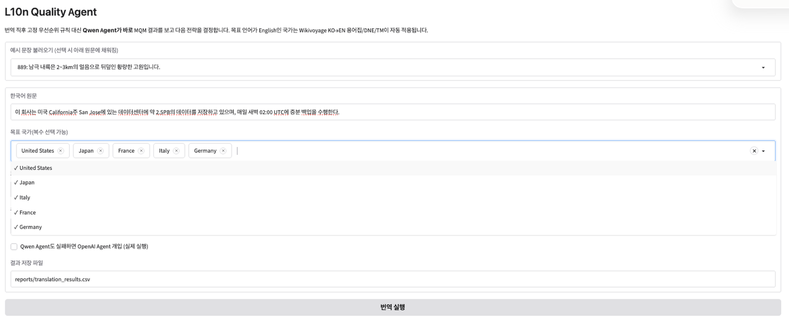
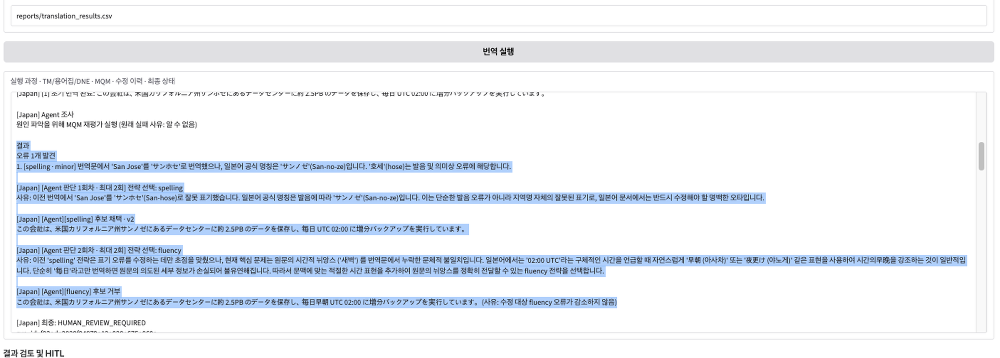
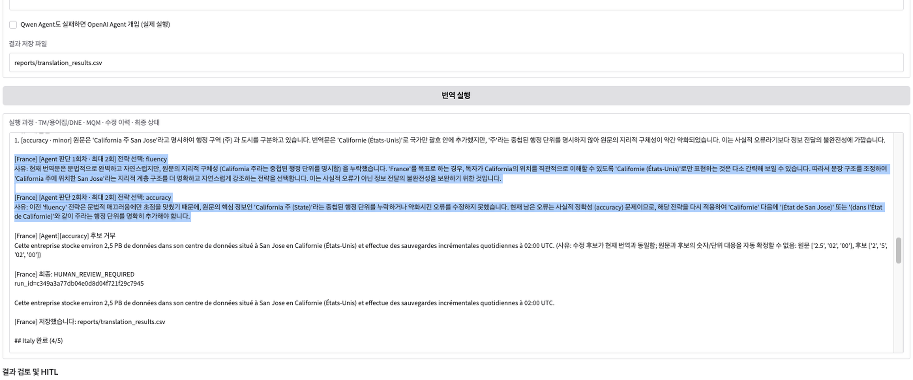

# L10n Quality Agent

> 한국어 문장을 목표 언어·로케일에 맞게 번역하고, **MQM 기반 평가 → 오류 유형별 전문 수정 → 재평가 → Agent의 전략 판단 → 사람 승인**까지 품질 개선 과정을 추적하는 LangChain 기반 번역 품질 개선 에이전트.
> A LangChain-based agent that translates Korean into locale-specific target languages, evaluates with MQM, fixes errors category by category, and keeps a full audit trail with human-in-the-loop approval.

   

<p align="center">
  
</p>

---

## ⚖️ 출처 및 독립성 고지 (Provenance & Independence Notice)

이 프로젝트는 **작성자 개인이 직접 기획·설계·구현한 개인 프로젝트**입니다.

- 작성자는 과거 Flitto에서 인턴으로 근무하며 다국어 번역 품질 평가·검수 업무를 경험했고, 이 경험을 통해 "번역 품질 문제를 어떻게 구조적으로 다룰 것인가"라는 **일반적인 문제의식**을 얻었습니다. 이 프로젝트는 인턴 종료 **이후**, 작성자 개인의 시간과 개인 장비에서 별도로 시작·개발되었습니다.
- 본 저장소에는 **Flitto 및 Flitto의 고객사가 보유한 어떠한 내부 자료도 포함되어 있지 않습니다.** 구체적으로 다음을 사용하지 않았습니다.
  - 회사 소스 코드, 프롬프트, 평가 스크립트, 모델·가중치, 설정 파일
  - 회사 또는 고객사의 데이터셋, 번역 메모리(TM), 용어집, 평가 결과, 보고서, 슬라이드
  - 회사 내부 시스템·도구·문서에 대한 접근 정보나 비공개 기술 정보
- 설계(MQM 오류 카테고리, 전문 도구 분할, Rollback, Human-in-the-loop 등)는 **공개된 표준·문헌·오픈소스 도구**(MQM, LangChain, Ollama 등)와 작성자 본인의 아이디어를 기반으로 하며, 작성자가 직접 만든 코드로 구현되었습니다.
- 사용 데이터는 모두 **공개 데이터셋(FLORES+)** 에서 가져왔고, 번역 메모리·용어집·DNE 목록은 이 공개 데이터를 바탕으로 **작성자가 새로 만든 것**입니다. 실행 예시에 쓰인 문장도 모두 작성자가 직접 만든 가상의 예시입니다.
- 이 저장소는 특정 회사나 고객사와 무관하며, 어떤 회사의 공식 프로젝트·제품도 아닙니다. 문서에 등장하는 제품·서비스·상표명은 각 소유자의 자산이며 설명 목적으로만 언급됩니다.

> *This is an independent personal project. It was started and built by the author on personal time and equipment after the author's internship ended. It contains no source code, prompts, models, datasets, glossaries, translation memories, evaluation results, or any other confidential or proprietary material from any former employer or its customers. All data comes from the public FLORES+ dataset, and all resources (TM, terminology, DNE) were newly derived from it by the author.*

---

## 왜 만들었나

AI 번역은 빠르지만, 특정 오류를 고쳐 달라고 하면 그 김에 다른 부분까지 바꾸거나 새 오류를 만들기도 합니다. 최종 결과만 보면 *무엇이 문제였고 왜 그렇게 고쳤는지* 되짚기도 어렵습니다.

그래서 이 프로젝트는 다음 원칙으로 설계했습니다.

1. 오류를 **MQM 카테고리**(accuracy / terminology / spelling / grammar / style / fluency)로 나눠서 다룬다.
2. 수정할 때마다 **전체를 다시 평가**하고, 오류가 줄지 않았거나 새 오류가 생기면 **Rollback**한다.
3. 숫자·단위·보호 용어는 LLM이 아닌 **Python 결정적 검사**로 한 번 더 막는다.
4. 정해진 순서만 따르지 않고 **Agent가 오류와 수정 이력을 보고 다음 전략을 스스로 판단**한다.
5. 로컬 Qwen Agent가 못 풀면 OpenAI로 한 번 더 시도하고, 그래도 안 되면 **사람이 검토**한다. 최종 승인은 항상 사람이 한다.
6. 모든 과정(수정 전후, 판단 근거, 채택/거부 사유)을 JSON으로 남긴다.

## 전체 흐름

```text
원문 입력 → 초기 번역 → MQM 평가
          → 오류 있음 → 카테고리별 전문 수정 → 재평가 → (개선 시 채택 / 아니면 Rollback)
          → 그래도 안 풀림 → Agent가 다음 전략 판단 → (필요 시 OpenAI 에스컬레이션)
          → 그마저 안 되면 사람 검토 → 최종 승인
```

<p align="center">
  
</p>

모델 호출은 **LangChain 체인(LCEL)** 으로, 실행 순서·채택 여부·검증은 **Python 코드**로 제어합니다. 더 자세한 구조는 [docs/ARCHITECTURE.md](docs/ARCHITECTURE.md)와 [docs/agent_flow.mmd](docs/agent_flow.mmd)를 참고하세요.

## 주요 기능

| 기능 | 설명 |
|---|---|
| 번역 체인 | `Prompt → ChatOllama(Qwen) → StrOutputParser`, 국가/로케일·보호 용어·TM·용어집·DNE 컨텍스트 주입 |
| MQM 평가 체인 | Pydantic 구조화 출력(`MQMResult`)으로 오류 위치·심각도·설명·수정 제안 수집 |
| 전문 수정 체인 6종 | accuracy, terminology, spelling, grammar, style, fluency 각각 해당 오류만 고치도록 제한 |
| 결정적 검증 | 숫자·단위·보호 용어·메타 주석 혼입 여부를 Python으로 검사 (`validation.py`) |
| Workflow / Agent | 고정 우선순위 Workflow와 Agent-first 모드 지원, 최대 시도 횟수·Rollback·재시도 |
| OpenAI 에스컬레이션 | Qwen Agent가 못 푼 사례를 `gpt-5-mini`로 한 번 더 시도 (키 없으면 Mock으로 자동 대체) |
| Human-in-the-loop | 승인·거부·직접 수정·AI 재수정, `human_review` 상태 |
| 추적성 | 실행마다 `run_id`와 전체 이력을 JSON 저장, 결과는 CSV 누적 |
| UI / CLI | Gradio 웹 UI(다중 국가 선택·단계별 진행 표시) 및 터미널 CLI |

## 실행 화면

**1. 입력 — 한국어 원문과 여러 목표 국가를 선택하면 국가별로 독립 실행됩니다.**


**2. 일본어 실행 — 'San Jose' 표기 오류를 `spelling` 전략으로 수정하고, 이어서 Agent가 `fluency`를 시도했지만 오류가 줄지 않아 후보를 거부(Rollback)한 뒤 사람 검토로 넘기는 과정.**



**3. 프랑스어 실행 — Agent가 `fluency` → `accuracy` 순으로 전략을 바꿔가며 판단 근거를 남기고, 숫자·단위 대응을 자동으로 확정할 수 없어 수정 후보를 거부한 뒤 `HUMAN_REVIEW_REQUIRED`로 종료.**



> 위 화면의 문장(예: 가상의 스타트업 `BlueBridge Labs`, 데이터센터 백업 안내)은 모두 작성자가 직접 만든 예시입니다. 실패 사례를 숨기지 않고 사람 검토로 넘기는 것이 이 시스템의 의도된 동작입니다.

## 폴더 구조

```text
.
├── l10n_quality_agent/        # 핵심 Python 패키지
│   ├── chains.py              # 번역·MQM·수정 체인 (LCEL)
│   ├── workflow.py            # 기본 실행 흐름과 상태 전환
│   ├── agent.py               # Agent 전략 선택과 재검증
│   ├── openai_agent.py        # OpenAI 에스컬레이션 (Mock 포함)
│   ├── validation.py          # 숫자·단위·보호 용어 결정적 검사
│   ├── tm.py / terminology.py / dne.py   # 번역 메모리·용어집·Do-Not-Edit
│   ├── ui.py / cli.py         # Gradio UI, CLI
│   └── storage.py / schemas.py / results_csv.py
├── data/flores_plus/          # 공개 FLORES+ 원본·선정 샘플과 파생 리소스
├── scripts/                   # 데이터 선정·리소스 생성·통합 실행 스크립트
├── tests/                     # 단위 테스트
├── reports/                   # 베이스라인·비교 실험 결과
├── runs/                      # 실행 시 생성되는 문장별 이력(JSON, git 제외)
├── docs/                      # 아키텍처 문서, 다이어그램, 화면 캡처
└── EXPERIMENT_LOG.md          # 한 번에 하나씩 바꾼 실험 기록
```

## 실행 방법

```bash
# 1) 환경
python -m venv .venv && source .venv/bin/activate
pip install langchain-core langchain-ollama langchain-openai pydantic gradio pandas pytest

# 2) 로컬 모델 (Ollama 필요)
ollama pull qwen3.5:4b

# 3) (선택) OpenAI 에스컬레이션
cp .env.example .env     # OPENAI_API_KEY 입력. 비워 두면 Mock으로 동작

# 4) 실행
python -m l10n_quality_agent.ui    # Gradio UI (기본 http://127.0.0.1:7860)
python -m l10n_quality_agent.cli   # 터미널
pytest -q tests                    # 테스트
```

## 데이터와 라이선스

- **코드**: [MIT License](LICENSE)
- **데이터**: `data/flores_plus/` 는 공개 데이터셋 **FLORES+** (Wikinews/Wikijunior/Wikivoyage 문장 기반, **CC BY-SA 4.0**)에서 가져왔거나 이를 바탕으로 파생한 것입니다. 자세한 출처와 조건은 [NOTICE.md](NOTICE.md)를 참고하세요.

## 현재 한계와 향후 계획

- 단일 문장 중심이며, Batch·비동기 Queue·다중 사용자는 미구현입니다.
- LangGraph Checkpointer(임의 중간 단계 복원)는 미구현입니다. 저장된 번역 버전에서 새 실행을 시작하는 방식입니다.
- 소형 로컬 모델(`qwen3.5:4b`) 기준이라 판단 품질에 한계가 있으며, 모델별 정량 비교와 Golden Dataset 평가는 향후 과제입니다.
- RAG/Vector DB는 현재 범위에서 제외했습니다.

## 작성자

Sihun Wang — 개인 프로젝트
