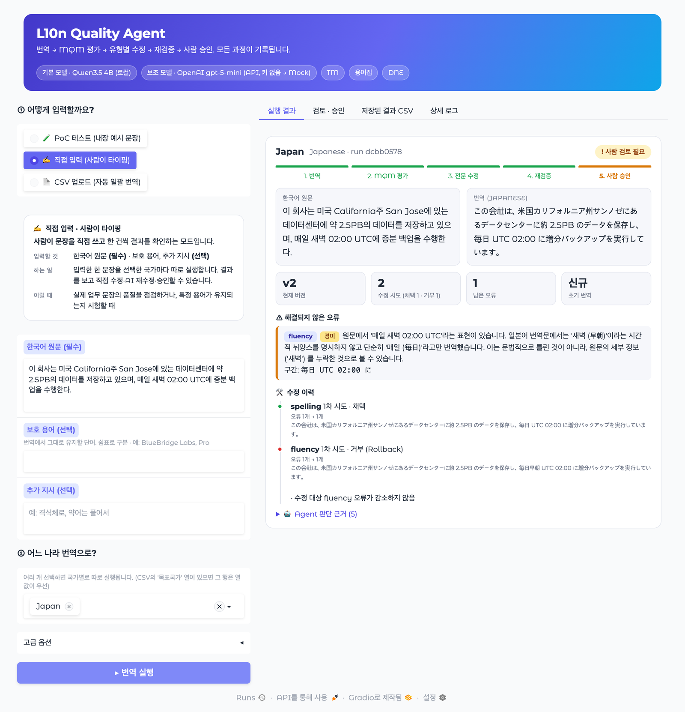
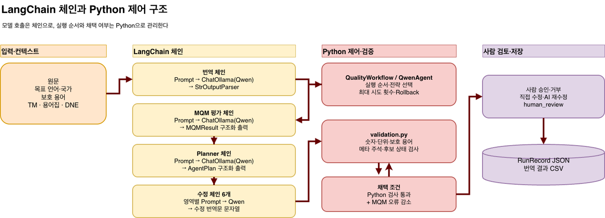
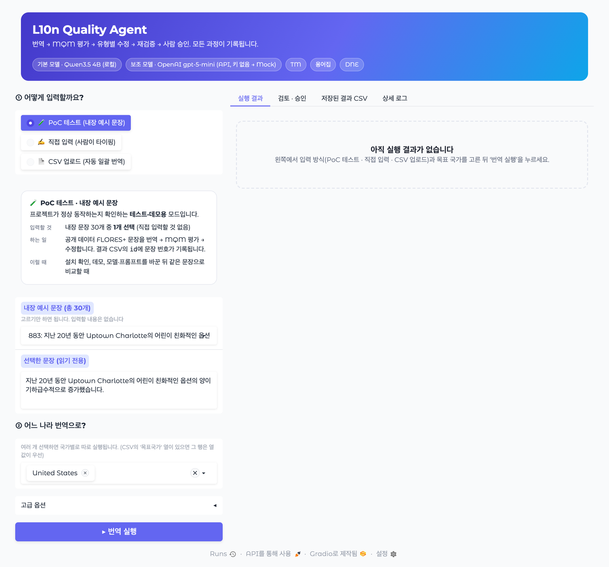
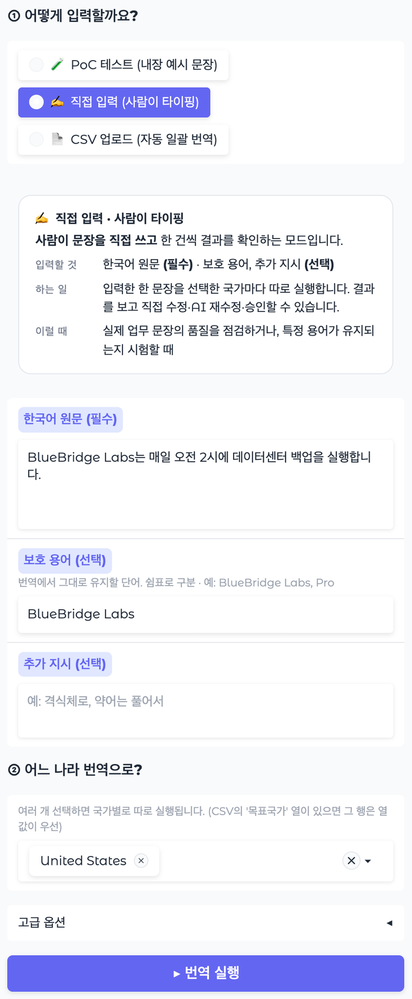
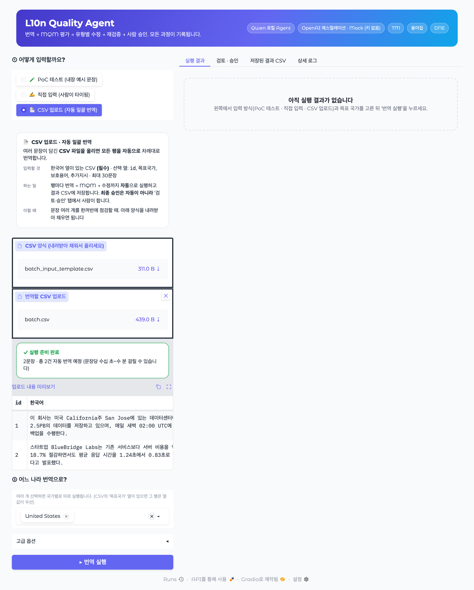
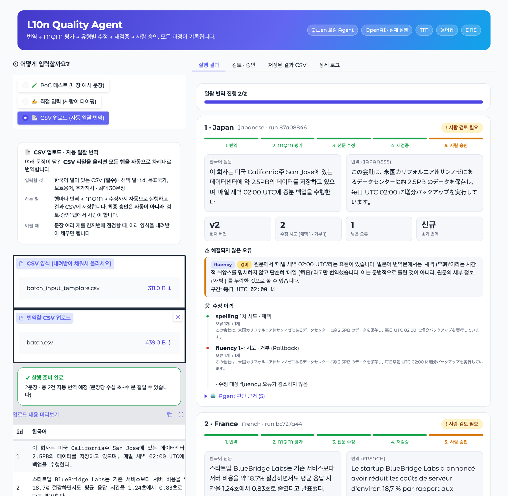
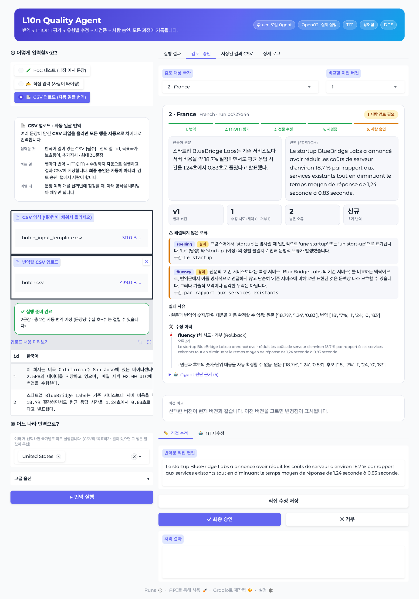

**English** · [한국어](README.ko.md)

# L10n Quality Agent

> **A translation-quality agent that manages AI translation problems as a loop: find → fix by category → re-verify → human approval.**
> It translates Korean into other languages, finds errors with a standard quality framework (MQM), fixes them one category at a time, re-checks every change, and leaves the final approval to a human.

### At a glance

- **What does it do?** It translates Korean sentences into English, Japanese, French and more, lets the AI find and fix translation errors itself, and records the whole fixing process.
- **Why is it needed?** Ask an AI to "fix just this" and it sometimes changes parts that were fine or introduces new errors. So this project assigns a dedicated tool per error type, re-evaluates everything after each fix, and rolls back if things got worse.
- **Who is it for?** People who work on translation / localization quality, and developers interested in automating translation quality.

### Glossary

| Term | Meaning |
|---|---|
| **L10n (Localization)** | Beyond moving words, adapting content to the target country's language, notation and culture. *Localization* has 10 letters between L and n, hence L10n. ([Wikipedia](https://en.wikipedia.org/wiki/Language_localisation)) |
| **MQM (Multidimensional Quality Metrics)** | A translation-quality evaluation framework that classifies errors as accuracy, terminology, spelling, grammar, style, fluency, etc. and grades their severity. ([themqm.org](https://themqm.org/)) |
| **Agent** | Instead of running in a fixed order, the LLM looks at the current state (remaining errors, earlier fix history) and chooses the next step itself. |
| **LCEL** | LangChain Expression Language. LangChain's way of chaining prompt → model → output parser with `\|`. ([docs](https://python.langchain.com/)) |
| **Human-in-the-loop (HITL)** | A design in which a human reviews and approves at points where automatic handling is hard to judge. |
| **TM (Translation Memory)** | Stores previously translated sentence pairs for reuse. |
| **DNE (Do Not Edit)** | A list that protects already-correct expressions from being changed in later fix steps. |
| **FLORES+** | A public translation-evaluation dataset covering roughly 200 languages. Used as this project's test data. ([GitHub](https://github.com/openlanguagedata/flores)) |
| **Ollama / Qwen** | A tool for running LLMs on your own computer ([ollama.com](https://ollama.com)) and an open model ([Qwen](https://github.com/QwenLM/Qwen3)). |


<p align="center">
  
</p>

## 🛠 Tech Stack

| Category | Technology |
|---|---|
| **Language** |  |
| **LLM framework** | -1C3C3C?style=flat-square&logo=langchain&logoColor=white)  |
| **Models** |    |
| **UI** |  |
| **Data & evaluation** |    |
| **Testing** |  |
| **License** |  |

---

## ⚖️ Provenance & Independence Notice

This is a **personal project planned, designed and implemented by the author alone**.

- While interning at Flitto, the author gained experience in multilingual translation quality evaluation and review, which gave rise to a **general line of thought**: "how can translation-quality problems be handled in a structured way?" This project was started and developed separately, **after** the internship ended, on the author's own time and equipment.
- This repository **contains no internal material owned by Flitto or its customers.** Specifically, none of the following was used:
  - Company source code, prompts, evaluation scripts, models / weights, configuration files
  - Company or customer datasets, translation memories (TM), glossaries, evaluation results, reports, slides
  - Access information or non-public technical information about company internal systems, tools or documents
- The design (MQM error categories, specialist tool split, rollback, human-in-the-loop, etc.) is based on **public standards, literature and open-source tools** (MQM, LangChain, Ollama, etc.) and the author's own ideas, and is implemented with code the author wrote.
- All data comes from the **public dataset (FLORES+)**; the translation memory, glossary and DNE list were **newly created by the author** from this public data. The sentences used in the run examples are also fictional examples the author wrote.
- This repository is unrelated to any specific company or customer and is not an official project or product of any company. Product, service and trademark names that appear in the documents belong to their respective owners and are mentioned for explanation only.

> *This is an independent personal project. It was started and built by the author on personal time and equipment after the author's internship ended. It contains no source code, prompts, models, datasets, glossaries, translation memories, evaluation results, or any other confidential or proprietary material from any former employer or its customers. All data comes from the public FLORES+ dataset, and all resources (TM, terminology, DNE) were newly derived from it by the author.*

---

## Why I built it

AI translation is fast, but when asked to fix one specific error it sometimes changes other parts too or creates new errors. Looking only at the final result, it is also hard to trace back *what the problem was and why it was fixed that way*.

So this project is designed on the following principles:

1. Handle errors by **MQM category** (accuracy / terminology / spelling / grammar / style / fluency).
2. After every fix, **re-evaluate everything**, and **roll back** if errors did not decrease or new ones appeared.
3. Numbers, units and protected terms are blocked once more by **deterministic Python checks**, not by the LLM.
4. Rather than following a fixed order, the **agent looks at the errors and fix history and decides the next strategy itself**.
5. If the local Qwen agent cannot solve it, try once more with OpenAI; if that still fails, **a human reviews it**. Final approval is always a human's.
6. Record the whole process (before / after each fix, reasoning, accept / reject reasons) as JSON.

## Overall flow

```text
Source input → initial translation → MQM evaluation
          → errors found → specialist fix per category → re-evaluate → (accept if improved / otherwise roll back)
          → still unsolved → agent decides next strategy → (escalate to OpenAI if needed)
          → still not solved → human review → final approval
```

<p align="center">
  
</p>

Model calls are made with **LangChain chains (LCEL)**, while execution order, accept / reject decisions and verification are controlled by **Python code**. For the full structure see [docs/ARCHITECTURE.md](docs/ARCHITECTURE.md) and [docs/agent_flow.mmd](docs/agent_flow.mmd).

The verification procedure, the scope of evidence interpretation, and pre-change checks are in [docs/VALIDATION_PROTOCOL.md](docs/VALIDATION_PROTOCOL.md).

## Main features

| Feature | Description |
|---|---|
| Translation chain | `Prompt → ChatOllama(Qwen) → StrOutputParser`, injecting country / locale, protected-term, TM, glossary and DNE context |
| MQM evaluation chain | Collects error location, severity, explanation and fix suggestion via Pydantic structured output (`MQMResult`) |
| 6 specialist fix chains | accuracy, terminology, spelling, grammar, style, fluency — each limited to fixing only its own errors |
| Deterministic validation | Python checks for numbers, units, protected terms and meta-comment leakage (`validation.py`) |
| Workflow / Agent | Fixed-priority workflow and agent-first mode, max attempts, rollback, retry |
| OpenAI escalation | Retries cases the Qwen agent could not solve with `gpt-5-mini` (automatically replaced by a Mock if there is no key) |
| Human-in-the-loop | Approve, reject, edit manually, AI re-fix, `human_review` state |
| Traceability | Every run saves a `run_id` and full history as JSON; results accumulate in CSV |
| UI / CLI | Gradio web UI (3 input modes: PoC, direct input, CSV batch; step-by-step progress; version diff) and terminal CLI |

## Screens

> The Gradio UI has an **English / 한국어** switch; the screenshots below show the Korean UI and are shared by both language versions.

### 3 input modes

Choosing a mode under **① How do you want to input?** at the top left also changes the explanation card describing *what you enter and what happens* in that mode. The flow after that (translation → MQM evaluation → fixing → human approval) is the same in every mode.

#### 🧪 PoC test — built-in sample sentences

- **Input:** pick 1 of 30 built-in sentences (no typing)
- **Use:** installation check, demo, before / after comparison when changing the model or prompt



#### ✍️ Direct input — typed by a person

- **Input:** Korean source text (required), protected terms and extra instructions (optional)
- **Use:** quality-check one sentence at a time



#### 📄 CSV upload — automatic batch translation

- **Input:** a CSV file with a `한국어` (Korean) column (optional columns: `id`, `목표국가` (target country), `보호용어` (protected terms), `추가지시` (extra instructions) · up to 30 sentences)
- **Use:** translate many sentences in batch automatically



- **CSV upload** validates the file the moment you upload it and previews "how many sentences and how many runs will execute". If there is a problem, it blocks execution and tells you why. The template is [`data/batch_input_template.csv`](data/batch_input_template.csv). To put several countries in one row, write `Japan|Italy`.
- If one sentence fails during a batch run, the rest continue.
- **What runs automatically is translation, evaluation and fixing**; **final approval is always a human's**.

### Run result

Shows **progress steps (translation → MQM evaluation → specialist fix → re-verification → human approval), status badges, source vs. translation comparison, fix history (accepted / rolled back), and the agent's reasoning** as a card per country. Below is a batch run of two CSV rows (Japanese and French).



### Review & approval

Check the remaining MQM errors and failure reasons, look at the **diff** against the previous version, then choose **edit manually / AI re-fix / final approve / reject**. The French example is a case where the number / unit correspondence could not be settled automatically, so the fix candidate was rejected (rolled back) and handed over as `HUMAN_REVIEW_REQUIRED`.



> The results in the screens (Japanese and French translations, MQM errors, fix history) were captured by reloading, in the UI, records actually produced with a local Qwen3.5 4B and saved in `runs/`. The sentences (e.g. the fictional startup `BlueBridge Labs`, a data-center backup notice) are all examples the author wrote. Not hiding failure cases and handing them to human review is the system's intended behavior.

## Folder structure

```text
.
├── l10n_quality_agent/        # core Python package
│   ├── chains.py              # translation / MQM / fix chains (LCEL)
│   ├── workflow.py            # default execution flow and state transitions
│   ├── agent.py               # agent strategy selection and re-verification
│   ├── openai_agent.py        # OpenAI escalation (incl. Mock)
│   ├── validation.py          # deterministic checks for numbers, units, protected terms
│   ├── tm.py / terminology.py / dne.py   # translation memory / glossary / Do-Not-Edit
│   ├── ui.py / ui_render.py   # Gradio UI, UI screen (HTML) rendering
│   ├── cli.py                 # CLI
│   └── storage.py / schemas.py / results_csv.py
├── data/flores_plus/          # public FLORES+ source, selected samples and derived resources
├── scripts/                   # data selection, resource generation, integrated run scripts
├── tests/                     # unit tests
├── reports/                   # baseline and comparison experiment results
├── runs/                      # per-sentence history created at run time (JSON, git-ignored)
├── docs/                      # architecture docs, diagrams, screen captures
└── EXPERIMENT_LOG.md          # experiment log, changing one thing at a time
```

## How to run

```bash
# 1) environment
python -m venv .venv && source .venv/bin/activate
pip install langchain-core langchain-ollama langchain-openai pydantic gradio pandas pytest

# 2) local model (requires Ollama)
ollama pull qwen3.5:4b

# 3) (optional) OpenAI escalation
cp .env.example .env     # enter OPENAI_API_KEY. Leave empty to run with the Mock

# 4) run
python -m l10n_quality_agent.ui    # Gradio UI (default http://127.0.0.1:7860)
python -m l10n_quality_agent.cli   # terminal
pytest -q tests                    # tests
```

### Install like an app (PWA)

The Gradio screen offers an **English / 한국어** switch in the browser and can be opened as an installed window in PWA-capable browsers.

- Local run: start `python -m l10n_quality_agent.ui` and open `http://127.0.0.1:7860` in Chrome on the same computer. Choose **Install app** from the browser menu.
- iPhone / Android: to install on a device, deploy the app and backend together to a server reachable over HTTPS. This repository does not include hosting, and the local Ollama model runs on the server where the app runs.
- Offline: screen resources you have visited may be cached, but translation runs and file saving still need the app's Python backend to keep running.
- File picker: choosing the result CSV at the final approval step uses macOS `osascript`, so it is currently incompatible with mobile and Windows.

## Data and license

- **Code**: [MIT License](LICENSE)
- **Data**: `data/flores_plus/` was taken or derived from the public dataset **FLORES+** (based on Wikinews / Wikijunior / Wikivoyage sentences, **CC BY-SA 4.0**). See [NOTICE.md](NOTICE.md) for details on sources and conditions.

## Current limitations and future plans

- CSV batch translation runs sequentially (up to 30 sentences). Async queues, parallel processing and multiple users are not implemented.
- LangGraph Checkpointer (restoring an arbitrary intermediate step) is not implemented. A new run is started from a saved translation version instead.
- It is based on a small local model (`qwen3.5:4b`), so judgment quality is limited; per-model quantitative comparison and Golden Dataset evaluation are future work.
- RAG / Vector DB is excluded from the current scope.

## Author

**Sihun Wang (왕시훈)**
