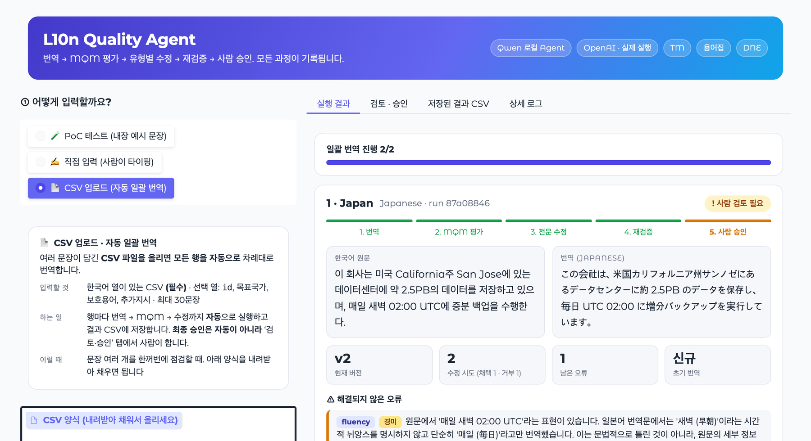
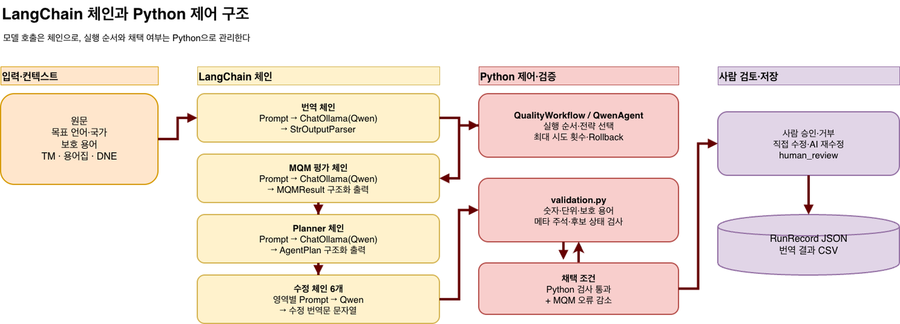
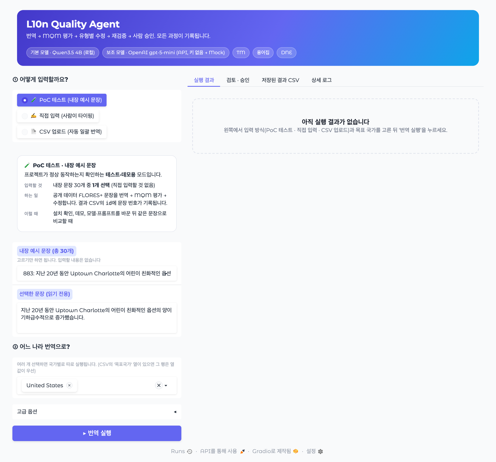
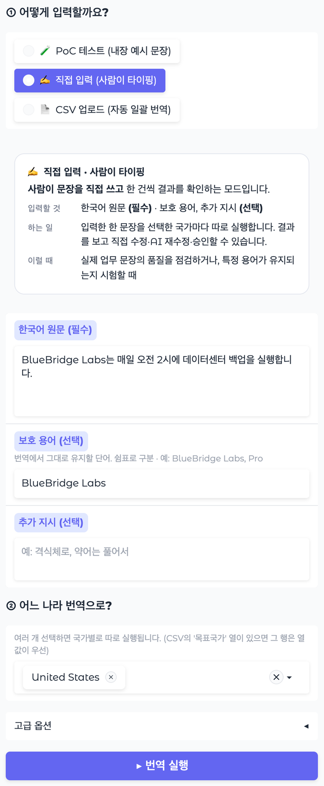
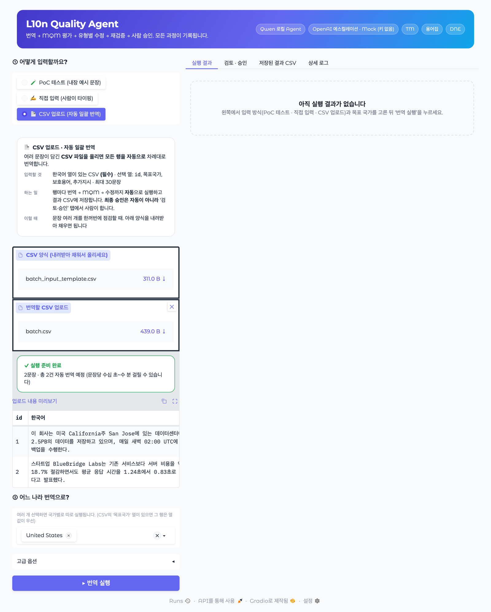
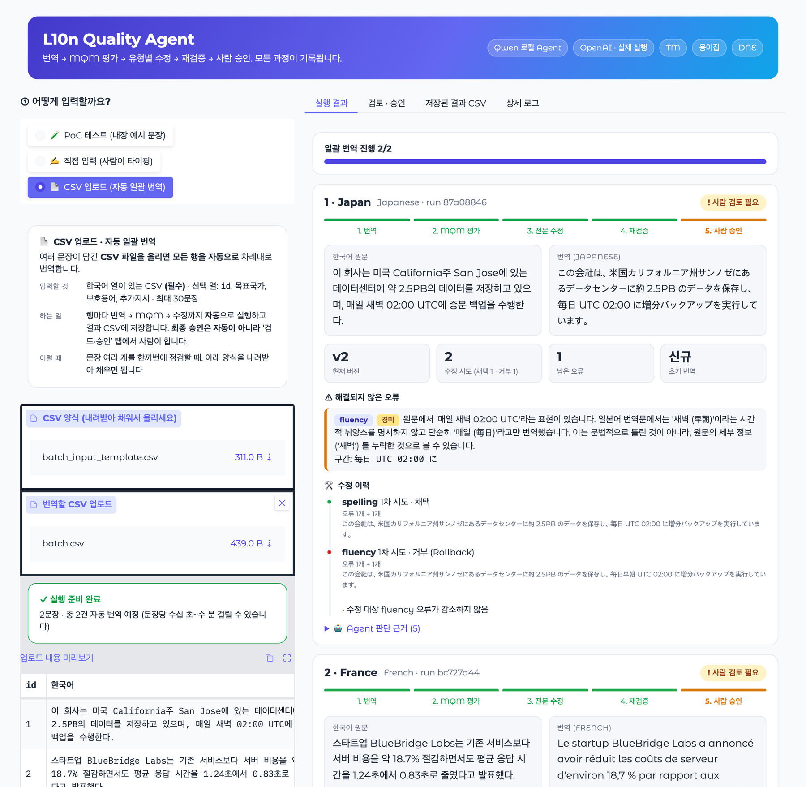
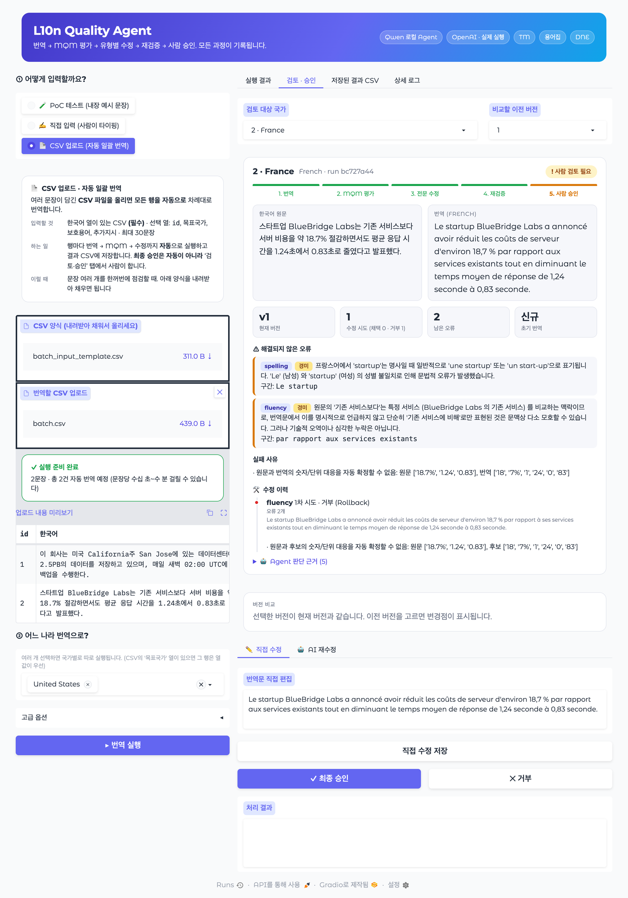

# L10n Quality Agent

> **AI 번역의 품질 문제를 "찾고 → 유형별로 고치고 → 다시 검증하고 → 사람이 승인"하는 과정으로 관리하는 번역 품질 개선 에이전트입니다.**
> *An agent that translates Korean into other languages, finds errors with a standard quality framework (MQM), fixes them one category at a time, re-checks every change, and leaves the final approval to a human.*

### 한눈에 이해하기

- **무엇을 하나요?** 한국어 문장을 영어·일본어·프랑스어 등으로 번역한 뒤, AI가 번역 오류를 스스로 찾아 고치고, 고친 과정을 전부 기록합니다.
- **왜 필요한가요?** AI에게 "여기만 고쳐줘"라고 해도 멀쩡한 부분까지 바꿔 버리거나 새 오류를 만들 때가 있습니다. 그래서 오류 종류별로 담당 도구를 나누고, 고칠 때마다 전체를 다시 평가해서 나빠지면 되돌립니다.
- **누가 쓰나요?** 번역·현지화 품질을 다루는 사람, 번역 품질 자동화에 관심 있는 개발자.

### 용어 설명

| 용어 | 뜻 |
|---|---|
| **L10n (Localization, 현지화)** | 단어를 옮기는 번역을 넘어, 대상 국가의 언어·표기·문화에 맞게 콘텐츠를 맞추는 작업. *Localization*은 L과 n 사이에 글자가 10개라서 L10n으로 줄여 씁니다. ([Wikipedia](https://en.wikipedia.org/wiki/Language_localisation)) |
| **MQM (Multidimensional Quality Metrics)** | 번역 오류를 정확성(accuracy)·용어(terminology)·철자(spelling)·문법(grammar)·문체(style)·유창성(fluency) 등으로 나누고 심각도를 매기는 번역 품질 평가 프레임워크. ([themqm.org](https://themqm.org/)) |
| **Agent (에이전트)** | 정해진 순서대로만 실행하지 않고, 현재 상태(남은 오류, 이전 수정 이력)를 보고 LLM이 다음에 할 일을 스스로 고르는 방식. |
| **LCEL** | LangChain Expression Language. 프롬프트 → 모델 → 출력 파서를 `|`로 이어 붙이는 LangChain의 체인 작성 방식. ([문서](https://python.langchain.com/)) |
| **Human-in-the-loop (HITL)** | 자동 처리 중 판단이 어려운 지점에서 사람이 검토·승인하도록 두는 설계. |
| **TM (Translation Memory)** | 이전에 번역한 문장 쌍을 저장해 재사용하는 번역 메모리. |
| **DNE (Do Not Edit)** | 이미 맞게 번역된 표현이 이후 수정 단계에서 바뀌지 않도록 보호하는 목록. |
| **FLORES+** | 200개 안팎 언어의 공개 번역 평가 데이터셋. 이 프로젝트의 테스트 데이터로 사용. ([GitHub](https://github.com/openlanguagedata/flores)) |
| **Ollama / Qwen** | 내 컴퓨터에서 LLM을 돌리는 도구([ollama.com](https://ollama.com))와 오픈 모델([Qwen](https://github.com/QwenLM/Qwen3)). |


<p align="center">
  
</p>

## 🛠 주요 기술 (Tech Stack)

| 구분 | 기술 |
|---|---|
| **언어** |  |
| **LLM 프레임워크** | -1C3C3C?style=for-the-badge&logo=langchain&logoColor=white)  |
| **모델** |    |
| **UI** |  |
| **데이터·평가** |    |
| **테스트** |  |
| **라이선스** |  |

---

## ⚖️ 출처 및 독립성 고지 (Provenance & Independence Notice)

이 프로젝트는 **작성자 개인이 직접 기획·설계·구현한 개인 프로젝트**입니다.

- 작성자는 과거 Flitto에서 인턴으로 근무하며 다국어 번역 품질 평가·검수 업무를 경험했고, 이 경험을 통해 "번역 품질 문제를 어떻게 구조적으로 다룰 것인가"라는 **일반적인 문제의식**을 얻었습니다. 이 프로젝트는 인턴 종료 **이후**, 작성자 개인의 시간과 개인 장비에서 별도로 시작·개발되었습니다.
- 본 저장소에는 **Flitto 및 Flitto의 고객사가 보유한 어떠한 내부 자료도 포함되어 있지 않습니다.** 구체적으로 다음을 사용하지 않았습니다.
  - 회사 소스 코드, 프롬프트, 평가 스크립트, 모델·가중치, 설정 파일
  - 회사 또는 고객사의 데이터셋, 번역 메모리(TM), 용어집, 평가 결과, 보고서, 슬라이드
  - 회사 내부 시스템·도구·문서에 대한 접근 정보나 비공개 기술 정보
- 설계(MQM 오류 카테고리, 전문 도구 분할, Rollback, Human-in-the-loop 등)는 **공개된 표준·문헌·오픈소스 도구**(MQM, LangChain, Ollama 등)와 작성자 본인의 아이디어를 기반으로 하며, 작성자가 직접 만든 코드로 구현되었습니다.
- 사용 데이터는 모두 **공개 데이터셋(FLORES+)** 에서 가져왔고, 번역 메모리·용어집·DNE 목록은 이 공개 데이터를 바탕으로 **작성자가 새로 만든 것**입니다. 실행 예시에 쓰인 문장도 모두 작성자가 직접 만든 가상의 예시입니다.
- 이 저장소는 특정 회사나 고객사와 무관하며, 어떤 회사의 공식 프로젝트·제품도 아닙니다. 문서에 등장하는 제품·서비스·상표명은 각 소유자의 자산이며 설명 목적으로만 언급됩니다.

> *This is an independent personal project. It was started and built by the author on personal time and equipment after the author's internship ended. It contains no source code, prompts, models, datasets, glossaries, translation memories, evaluation results, or any other confidential or proprietary material from any former employer or its customers. All data comes from the public FLORES+ dataset, and all resources (TM, terminology, DNE) were newly derived from it by the author.*

---

## 왜 만들었나

AI 번역은 빠르지만, 특정 오류를 고쳐 달라고 하면 그 김에 다른 부분까지 바꾸거나 새 오류를 만들기도 합니다. 최종 결과만 보면 *무엇이 문제였고 왜 그렇게 고쳤는지* 되짚기도 어렵습니다.

그래서 이 프로젝트는 다음 원칙으로 설계했습니다.

1. 오류를 **MQM 카테고리**(accuracy / terminology / spelling / grammar / style / fluency)로 나눠서 다룬다.
2. 수정할 때마다 **전체를 다시 평가**하고, 오류가 줄지 않았거나 새 오류가 생기면 **Rollback**한다.
3. 숫자·단위·보호 용어는 LLM이 아닌 **Python 결정적 검사**로 한 번 더 막는다.
4. 정해진 순서만 따르지 않고 **Agent가 오류와 수정 이력을 보고 다음 전략을 스스로 판단**한다.
5. 로컬 Qwen Agent가 못 풀면 OpenAI로 한 번 더 시도하고, 그래도 안 되면 **사람이 검토**한다. 최종 승인은 항상 사람이 한다.
6. 모든 과정(수정 전후, 판단 근거, 채택/거부 사유)을 JSON으로 남긴다.

## 전체 흐름

```text
원문 입력 → 초기 번역 → MQM 평가
          → 오류 있음 → 카테고리별 전문 수정 → 재평가 → (개선 시 채택 / 아니면 Rollback)
          → 그래도 안 풀림 → Agent가 다음 전략 판단 → (필요 시 OpenAI 에스컬레이션)
          → 그마저 안 되면 사람 검토 → 최종 승인
```

<p align="center">
  
</p>

모델 호출은 **LangChain 체인(LCEL)** 으로, 실행 순서·채택 여부·검증은 **Python 코드**로 제어합니다. 더 자세한 구조는 [docs/ARCHITECTURE.md](docs/ARCHITECTURE.md)와 [docs/agent_flow.mmd](docs/agent_flow.mmd)를 참고하세요.

## 주요 기능

| 기능 | 설명 |
|---|---|
| 번역 체인 | `Prompt → ChatOllama(Qwen) → StrOutputParser`, 국가/로케일·보호 용어·TM·용어집·DNE 컨텍스트 주입 |
| MQM 평가 체인 | Pydantic 구조화 출력(`MQMResult`)으로 오류 위치·심각도·설명·수정 제안 수집 |
| 전문 수정 체인 6종 | accuracy, terminology, spelling, grammar, style, fluency 각각 해당 오류만 고치도록 제한 |
| 결정적 검증 | 숫자·단위·보호 용어·메타 주석 혼입 여부를 Python으로 검사 (`validation.py`) |
| Workflow / Agent | 고정 우선순위 Workflow와 Agent-first 모드 지원, 최대 시도 횟수·Rollback·재시도 |
| OpenAI 에스컬레이션 | Qwen Agent가 못 푼 사례를 `gpt-5-mini`로 한 번 더 시도 (키 없으면 Mock으로 자동 대체) |
| Human-in-the-loop | 승인·거부·직접 수정·AI 재수정, `human_review` 상태 |
| 추적성 | 실행마다 `run_id`와 전체 이력을 JSON 저장, 결과는 CSV 누적 |
| UI / CLI | Gradio 웹 UI(PoC·직접 입력·CSV 일괄 3가지 입력 방식, 단계별 진행 표시, 버전 diff) 및 터미널 CLI |

## 실행 화면

### 입력 방식 3가지

왼쪽 맨 위 **① 어떻게 입력할까요?** 에서 방식을 고르면, 그 방식에서 *무엇을 입력하고 무슨 일을 하는지* 설명 카드가 함께 바뀝니다. 어느 방식이든 이후 흐름(번역 → MQM 평가 → 수정 → 사람 승인)은 같습니다.

| 방식 | 입력할 것 | 용도 |
|---|---|---|
| 🧪 **PoC 테스트** | 내장 예시 문장 30개 중 1개 선택 (타이핑 없음) | 설치 확인, 데모, 모델·프롬프트 변경 전후 비교 |
| ✍️ **직접 입력** | 한국어 원문(필수), 보호 용어·추가 지시(선택) | 사람이 한 문장씩 넣어 품질 점검 |
| 📄 **CSV 업로드** | `한국어` 열이 있는 CSV (선택 열: `id`, `목표국가`, `보호용어`, `추가지시`, 최대 30문장) | 여러 문장을 **자동으로 일괄 번역** |

<table>
  <tr>
    <td width="45%" valign="top">
      <h4>🧪 PoC 테스트</h4>
      <p><b>입력:</b> 내장 문장 30개 중 1개 선택 (타이핑 없음)</p>
      <p><b>용도:</b> 설치 확인, 데모, 모델·프롬프트 변경 전후 비교</p>
    </td>
    <td width="55%"></td>
  </tr>
  <tr>
    <td valign="top">
      <h4>✍️ 직접 입력</h4>
      <p><b>입력:</b> 한국어 원문(필수), 보호 용어·추가 지시(선택)</p>
      <p><b>용도:</b> 사람이 한 문장씩 넣어 품질 점검</p>
    </td>
    <td></td>
  </tr>
  <tr>
    <td valign="top">
      <h4>📄 CSV 업로드</h4>
      <p><b>입력:</b> <code>한국어</code> 열이 있는 CSV 파일</p>
      <p><b>용도:</b> 여러 문장을 자동으로 일괄 번역</p>
    </td>
    <td></td>
  </tr>
</table>

- **CSV 업로드**는 파일을 올리는 즉시 검증하고 "몇 문장·몇 건이 실행될지"를 미리 보여줍니다. 문제가 있으면 실행을 막고 이유를 알려줍니다. 양식은 [`data/batch_input_template.csv`](data/batch_input_template.csv)입니다. 한 행에 여러 국가를 넣을 때는 `Japan|Italy`처럼 씁니다.
- 일괄 실행 중 한 문장이 실패해도 나머지는 계속 진행합니다.
- **자동으로 하는 것은 번역·평가·수정까지**이고, **최종 승인은 항상 사람이** 합니다.

### 실행 결과

**진행 단계(번역 → MQM 평가 → 전문 수정 → 재검증 → 사람 승인), 상태 배지, 원문·번역 비교, 수정 이력(채택/Rollback), Agent 판단 근거**를 국가별 카드로 보여줍니다. 아래는 CSV 두 행(일본어·프랑스어)을 일괄 실행한 화면입니다.



### 검토 · 승인

남은 MQM 오류와 실패 사유를 확인하고, 이전 버전과의 **변경점(diff)** 을 본 뒤 **직접 수정 / AI 재수정 / 최종 승인 / 거부**를 선택합니다. 프랑스어 예시는 숫자·단위 대응을 자동으로 확정할 수 없어 수정 후보를 거부(Rollback)하고 `HUMAN_REVIEW_REQUIRED`로 넘긴 사례입니다.



> 화면 속 결과(일본어·프랑스어 번역, MQM 오류, 수정 이력)는 로컬 Qwen3.5 4B로 실제 실행해 `runs/`에 저장된 기록을 UI에서 다시 불러와 캡처한 것입니다. 문장(예: 가상의 스타트업 `BlueBridge Labs`, 데이터센터 백업 안내)은 모두 작성자가 직접 만든 예시입니다. 실패 사례를 숨기지 않고 사람 검토로 넘기는 것이 이 시스템의 의도된 동작입니다.

## 폴더 구조

```text
.
├── l10n_quality_agent/        # 핵심 Python 패키지
│   ├── chains.py              # 번역·MQM·수정 체인 (LCEL)
│   ├── workflow.py            # 기본 실행 흐름과 상태 전환
│   ├── agent.py               # Agent 전략 선택과 재검증
│   ├── openai_agent.py        # OpenAI 에스컬레이션 (Mock 포함)
│   ├── validation.py          # 숫자·단위·보호 용어 결정적 검사
│   ├── tm.py / terminology.py / dne.py   # 번역 메모리·용어집·Do-Not-Edit
│   ├── ui.py / ui_render.py   # Gradio UI, UI 화면(HTML) 렌더링
│   ├── cli.py                 # CLI
│   └── storage.py / schemas.py / results_csv.py
├── data/flores_plus/          # 공개 FLORES+ 원본·선정 샘플과 파생 리소스
├── scripts/                   # 데이터 선정·리소스 생성·통합 실행 스크립트
├── tests/                     # 단위 테스트
├── reports/                   # 베이스라인·비교 실험 결과
├── runs/                      # 실행 시 생성되는 문장별 이력(JSON, git 제외)
├── docs/                      # 아키텍처 문서, 다이어그램, 화면 캡처
└── EXPERIMENT_LOG.md          # 한 번에 하나씩 바꾼 실험 기록
```

## 실행 방법

```bash
# 1) 환경
python -m venv .venv && source .venv/bin/activate
pip install langchain-core langchain-ollama langchain-openai pydantic gradio pandas pytest

# 2) 로컬 모델 (Ollama 필요)
ollama pull qwen3.5:4b

# 3) (선택) OpenAI 에스컬레이션
cp .env.example .env     # OPENAI_API_KEY 입력. 비워 두면 Mock으로 동작

# 4) 실행
python -m l10n_quality_agent.ui    # Gradio UI (기본 http://127.0.0.1:7860)
python -m l10n_quality_agent.cli   # 터미널
pytest -q tests                    # 테스트
```

## 데이터와 라이선스

- **코드**: [MIT License](LICENSE)
- **데이터**: `data/flores_plus/` 는 공개 데이터셋 **FLORES+** (Wikinews/Wikijunior/Wikivoyage 문장 기반, **CC BY-SA 4.0**)에서 가져왔거나 이를 바탕으로 파생한 것입니다. 자세한 출처와 조건은 [NOTICE.md](NOTICE.md)를 참고하세요.

## 현재 한계와 향후 계획

- CSV 일괄 번역은 순차 실행(최대 30문장)입니다. 비동기 Queue·병렬 처리·다중 사용자는 미구현입니다.
- LangGraph Checkpointer(임의 중간 단계 복원)는 미구현입니다. 저장된 번역 버전에서 새 실행을 시작하는 방식입니다.
- 소형 로컬 모델(`qwen3.5:4b`) 기준이라 판단 품질에 한계가 있으며, 모델별 정량 비교와 Golden Dataset 평가는 향후 과제입니다.
- RAG/Vector DB는 현재 범위에서 제외했습니다.

## 작성자

**Sihun Wang (왕시훈)** — 개인 프로젝트

- ORCID: [0009-0007-0605-7760](https://orcid.org/0009-0007-0605-7760)
- GitHub: [@sihunwang-skala](https://github.com/sihunwang-skala) (현재 사용 중인 계정) · 이전 계정 [@sihunwang](https://github.com/sihunwang)과 동일 인물이 운영합니다.
- 일리노이 대학교(UIUC) 통계학 교과서 *Applied Statistics with R* (David Dalpiaz, STAT 420) 기여자로 [책의 감사 명단](https://book.stat420.org/)에 이름이 올라 있습니다.
