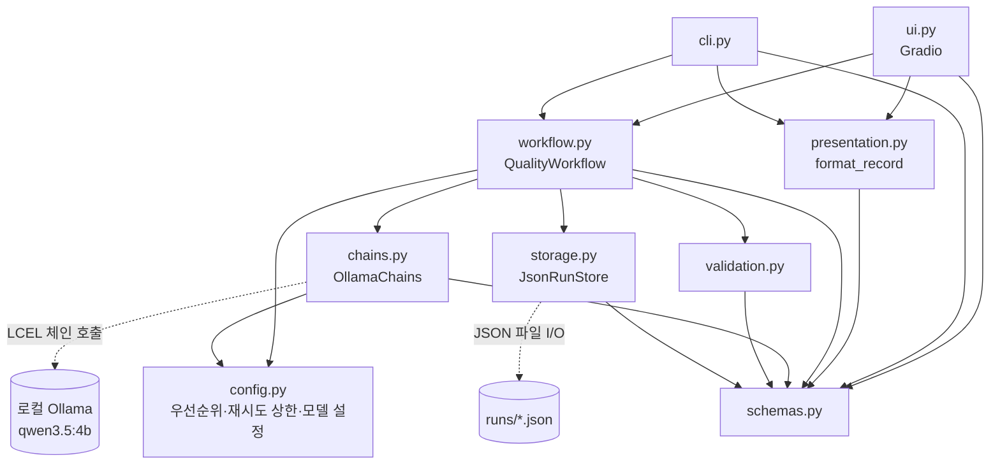
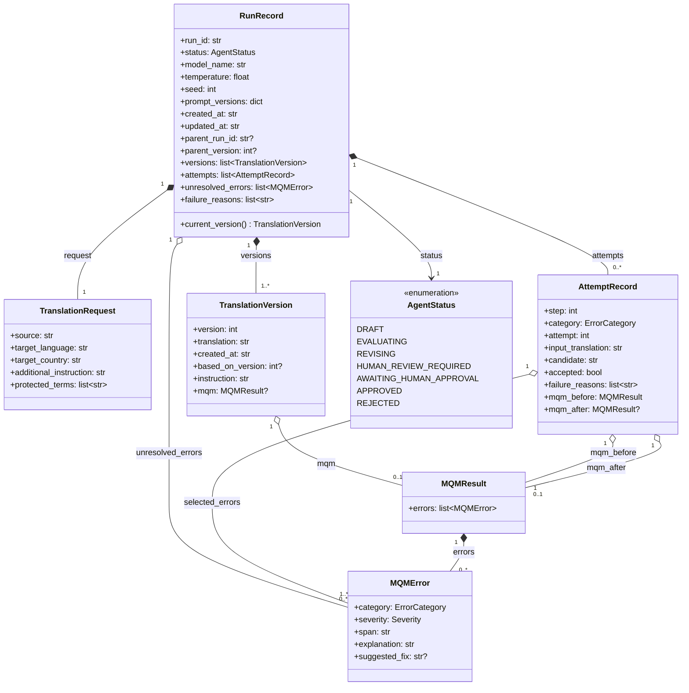
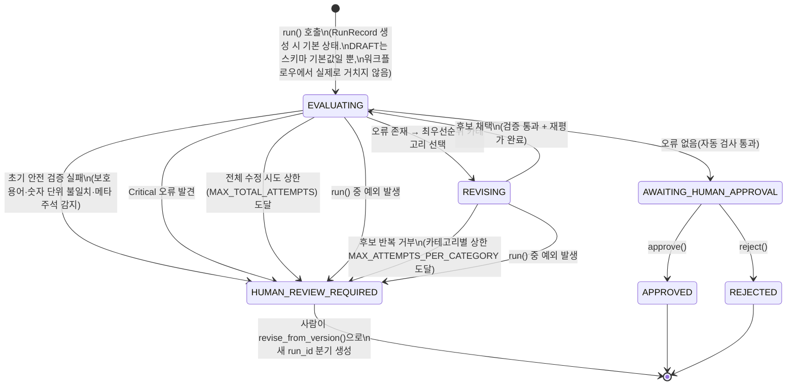
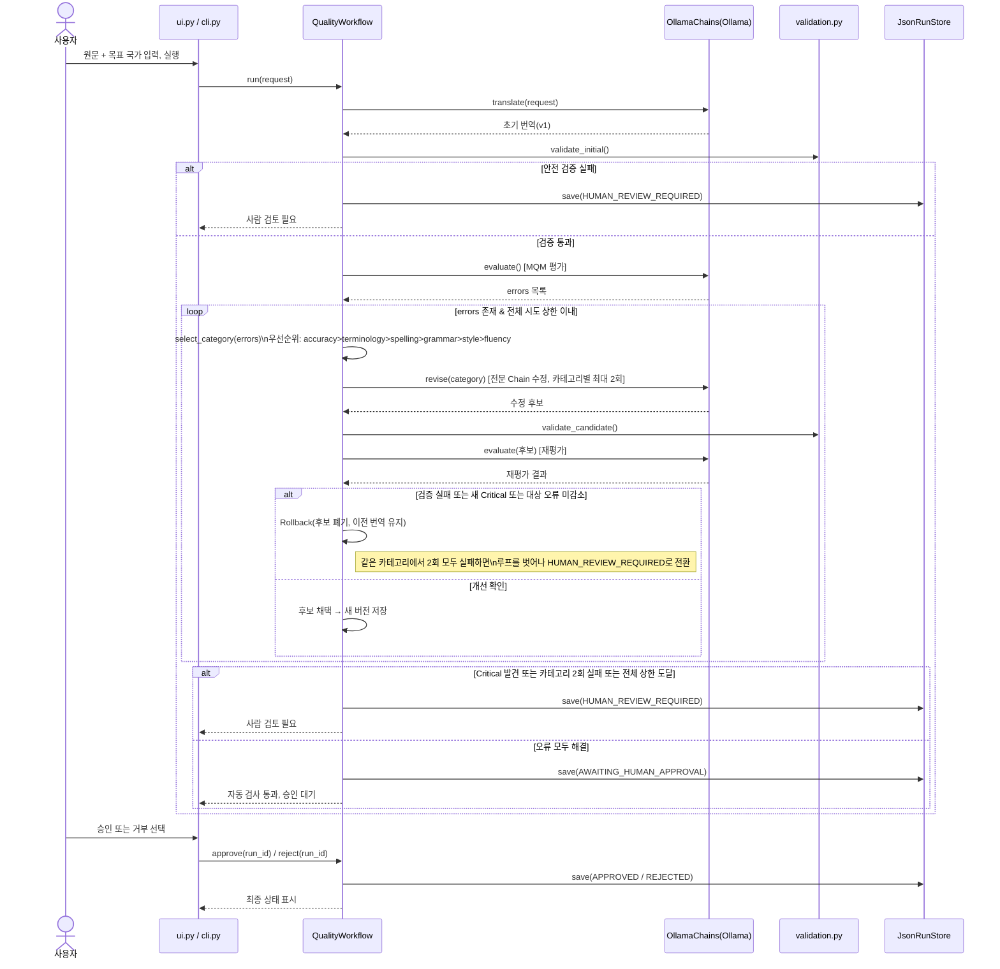

# 아키텍처 및 스키마 의존성

코드(`l10n_quality_agent/*.py`)를 기준으로 실제 호출·데이터 의존관계를 그렸다. 다이어그램은 Mermaid이며 GitHub, VS Code(내장 Markdown 미리보기)에서 별도 확장 없이 렌더링된다. 구현되지 않은 기능(LangGraph Checkpointer, Batch/비동기 큐 등)은 그리지 않는다.

## 1. 모듈 의존 관계

- `workflow.py`가 유일한 오케스트레이터다. `ui.py`/`cli.py`는 요청을 만들 때 쓰는 `TranslationRequest`(`schemas.py`)와 `QualityWorkflow`까지만 알고, 체인·검증·저장의 세부 구현은 모른다. (두 진입점 모두 `TranslationRequest`를 직접 생성하므로 `schemas.py`로 가는 화살표가 따로 있다 — `presentation.py`를 거치는 것과는 별개 경로다.)
- `chains.py`는 Ollama와 통신하는 유일한 지점이다. `validation.py`는 모델 결과를 신뢰하지 않고 결정적 규칙(정규식·집합 비교·주석 마커 탐지)으로만 판단한다.
- `schemas.py`는 다른 모든 모듈이 의존하는 공통 데이터 계약이며, 역방향 의존은 없다.

## 2. Pydantic 스키마 관계 (`schemas.py`)

- `RunRecord`가 실행 하나의 전체 이력을 소유하는 루트 애그리게이트다. `versions`는 채택된 번역만, `attempts`는 채택·거부를 포함한 모든 시도를 담는다 — 그래서 `attempts.length >= versions.length - 1`.
- `model_name`/`temperature`/`seed`/`prompt_versions`/`created_at`/`updated_at`은 실행 시점의 재현성·감사용 스냅샷이다. 나중에 `config.py`의 기본값이 바뀌어도(예: 이번에 `NUM_PREDICT`를 512→1536으로 바꾼 것) 과거 `RunRecord`에 저장된 값은 그대로 남는다.
- `TranslationVersion.based_on_version` / `RunRecord.parent_run_id`+`parent_version`으로 재수정 계보를 추적한다 (`revise_from_version`이 새 `run_id`를 만들며 이전 실행을 부모로 참조).
- `MQMResult`는 평가 시점의 스냅샷이라 `TranslationVersion.mqm`(그 버전 확정 시 평가)과 `AttemptRecord.mqm_before/after`(시도 전후 비교) 두 군데서 각각 독립적으로 보관된다 — 같은 타입이지만 의미가 다르다.

## 3. 실행 상태 머신 (`workflow.py`의 `AgentStatus` 전이)

- `RunRecord`는 생성되는 즉시 `EVALUATING`으로 시작한다(`DRAFT`는 스키마 기본값일 뿐 `workflow.py`가 실제로 거치는 상태가 아니다). 그래서 초기 안전 검증 실패도 `[*]`가 아니라 `EVALUATING`에서 나가는 전이다 — 이전 판(Checkpoint 03 최초본)에서는 이 부분을 `[*] --> HUMAN_REVIEW_REQUIRED`로 잘못 그렸었다.
- `run()`의 `try/except Exception`이 `_improve()` 호출 전체를 감싸고 있어서, 초기 번역뿐 아니라 `_improve()` 내부(평가·수정 체인 호출)에서 발생하는 예외도 전부 `HUMAN_REVIEW_REQUIRED`로 떨어진다. 그래서 이 예외 경로는 `EVALUATING`과 `REVISING` 양쪽에서 다 나올 수 있다 — 이전 판에서는 이 경로 자체가 다이어그램에 없었다.
- `REVISING`은 자기 자신으로 루프를 돌지 않는다 — 후보 하나를 만들 때마다 반드시 `EVALUATING`(채택) 또는 `HUMAN_REVIEW_REQUIRED`(거부+상한)로 빠진다. 실제 반복은 `_improve()`의 `while evaluation.errors:` 루프가 담당하고, 상태값 자체는 그 루프 안에서 `REVISING`→`EVALUATING`을 오간다.
- `HUMAN_REVIEW_REQUIRED`는 종단 상태가 아니라 "이 run은 여기서 멈추고, 사람이 판단해서 새 run을 만들라"는 신호다. 그래서 그림에서 `[*]`로 나가되 새 run의 `parent_run_id`로 이어진다.
- `critical_count`, `category_count`, `validate_candidate/initial/spans`, `detect_meta_commentary_leak`(모두 `validation.py`)가 이 상태 전이를 좌우하는 유일한 결정 로직이며, LLM 출력(`chains.py`)은 후보만 만들 뿐 상태를 직접 바꾸지 않는다.

## 4. 실행 흐름 시퀀스 다이어그램 (발표용)

사용자 입력 한 건이 승인/거부까지 어떻게 흘러가는지, Rollback과 카테고리별 최대 2회 재시도 후 사람 검토 전환까지 포함해서 그렸다.

- 실선 화살표(`->>`)는 요청, 점선 화살표(`-->>`)는 응답/결과 반환이다.
- "전체 시도 상한"은 `MAX_TOTAL_ATTEMPTS`(현재 12), "카테고리별 최대 2회"는 `MAX_ATTEMPTS_PER_CATEGORY`(현재 2)를 가리킨다 — `config.py`에 있는 실제 값 그대로다.
- 이 그림은 현재 구현된 경로만 담았다. LangGraph Checkpointer 기반 임의 중간 복원, Batch/비동기 큐, 다중 사용자 동시 처리는 미구현이므로 포함하지 않았다.
